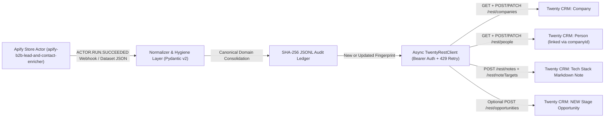

# twenty-crm-apify-b2b-sync

Asynchronous Python 3.11+ sync tool that takes the company and contact records produced by the public Apify Store Actor [`thanh81646/apify-b2b-lead-and-contact-enricher`](https://apify.com/thanh81646/apify-b2b-lead-and-contact-enricher) and writes them into **Twenty CRM** (Cloud or self-hosted) through Twenty's REST API.

**Status:** a portfolio/demo project. It has not been used in production. The automated tests and the `--demo-mock` mode run against an in-memory mock of Twenty's `/rest/*` endpoints (`InMemoryTwentyMockTransport`), and the tests mock the Apify dataset API too; nothing here has been run against a live Twenty workspace by the tests. The payload shapes follow Twenty's open-source schema (`twentyhq/twenty`); check them against your Twenty version before a real sync.

Built by **Trung Thanh Tran** ([Portfolio](https://trungthanhtran.vercel.app) | [Apify Store](https://apify.com/thanh81646) | [GitHub](https://github.com/Tthanh2k6)).

---

## Architecture Overview



---

## Key Engineering Capabilities

1. **Twenty composite fields:** Maps flat scraper records into Twenty's nested composite field structures (`LinksMetadata`, `EmailsMetadata`, `PhonesMetadata`, `FullNameMetadata`, `AddressMetadata`, `CurrencyMetadata` in micros, and `RichTextMetadata` `bodyV2.markdown`) defined in `twentyhq/twenty`.
2. **Domain consolidation and upsert:** Records for `https://www.example.com/` and `https://example.com/contact` are merged (emails, phones, social links, tech-stack tags) under one canonical domain, `example.com`. Before writing, it queries `/rest/companies?filter=domainName.primaryLinkUrl[ilike]:%...%` and updates an existing `Company` instead of creating a duplicate.
3. **Email cleanup and contact ranking:** Rejects telemetry DSNs (`sentry.io`, `wixpress.com`), image asset false positives (`banner@2x.png`), placeholder domains (`example.com`), and `noreply@` addresses and ranks personal-looking inboxes (`jane.doe@`) ahead of generic role aliases (`hello@`, `info@`) for `emails.primaryEmail`.
4. **Retries:** Uses `httpx.AsyncClient` with `Retry-After` header parsing and exponential backoff across `HTTP 429`, `500`, `502`, `503`, and `504` responses.
5. **Append-only audit ledger:** Persists deterministic SHA-256 hashes in `sync_audit.jsonl` so repeated Apify webhook deliveries or re-runs skip leads already synced. The hash covers only the canonical domain, the cleaned emails and the tech stack, so a lead whose name, phone or address changed but whose domain/emails/tech stack did not is also skipped.
6. **Apify webhook handler:** Includes `twenty_sync.webhook` with constant-time `HMAC-SHA256` signature verification for automated `ACTOR.RUN.SUCCEEDED` ingestion.

---

## Field Mapping (Apify Actor -> Twenty CRM Standard Objects)

| Source Field (`apify-b2b-lead-and-contact-enricher`) | Target Twenty Object | Target Twenty Field & Composite Structure |
| :--- | :--- | :--- |
| `url` (canonicalized host) | `Company` | `domainName: { primaryLinkUrl, primaryLinkLabel, secondaryLinks }` |
| `company_name` (SEO-cleaned) | `Company` | `name` (`string`) |
| `social_profiles.linkedin` (`/company/`) | `Company` | `linkedinLink: { primaryLinkUrl, primaryLinkLabel }` |
| `social_profiles` (`twitter_x`, `youtube`, etc.) | `Company` | `domainName.secondaryLinks[]` (`{ url, label }`) |
| `city`, `country` | `Company` | `address: { addressCity, addressCountry }` |
| `emails` (cleaned & priority-ranked) | `Person` | `emails: { primaryEmail, additionalEmails }` + `name: { firstName, lastName }` |
| `phones` (E.164 & national parser) | `Person` | `phones: { primaryPhoneNumber, primaryPhoneCallingCode, primaryPhoneCountryCode, additionalPhones }` |
| Resolved `Company.id` | `Person` | `companyId` (`UUID` foreign key) |
| `tech_stack`, `json_ld_types`, `meta_description` | `Note` + `NoteTarget` | `title` + `bodyV2: { markdown }` linked via `targetCompanyId` & `targetPersonId` |
| `estimated_deal_usd` (optional) | `Opportunity` | `stage: "NEW"`, `amount: { amountMicros, currencyCode }`, `companyId`, `pointOfContactId` |

---

## Quickstart

### 1. Install

```bash
pip install -e ".[dev]"
```

### 2. Offline Dry-Run (Inspect Exact Twenty Payloads)

```bash
python -m twenty_sync.cli --dry-run --create-opportunities --output-preview ./preview_payloads.json
```

### 3. Run against the in-memory mock (`--demo-mock`)

Executes the full HTTP lookup, upsert, Note attachment, Opportunity creation, and JSONL ledger pipeline against an in-memory Twenty CRM `/rest/*` server:

```bash
python -m twenty_sync.cli --demo-mock --create-opportunities --ledger ./demo_sync_audit.jsonl
```

### 4. Live Sync to Twenty Cloud or Self-Hosted Instance

Generate an API key in your Twenty workspace under **Settings -> Developers -> API**, then run:

```bash
export TWENTY_BASE_URL="https://api.twenty.com"
export TWENTY_API_KEY="your_twenty_bearer_token"

# Sync from a local Apify export file
python -m twenty_sync.cli --input ./data/sample_apify_b2b_leads.json --create-opportunities --ledger ./sync_audit.jsonl

# Or pull directly from a completed Apify Actor Dataset ID
python -m twenty_sync.cli --apify-dataset-id "your_apify_dataset_id" --ledger ./sync_audit.jsonl
```

---

## Configuring Automated Apify Webhooks

In the Apify Console for [`thanh81646/apify-b2b-lead-and-contact-enricher`](https://apify.com/thanh81646/apify-b2b-lead-and-contact-enricher):

1. Open **Integrations -> Webhooks -> Create new webhook**.
2. Select event **`Run succeeded` (`ACTOR.RUN.SUCCEEDED`)**.
3. Sign requests with `APIFY_WEBHOOK_SECRET` in `X-Apify-Webhook-Signature` and pass the incoming payload to `verify_apify_webhook_signature()` + `handle_apify_webhook_event()` in `src/twenty_sync/webhook.py`.

---

## Running the Test Suite

The tests use the in-memory Twenty mock and `httpx.MockTransport` for Apify; no network access or API keys are needed.

```bash
pytest -v
```

Or with Python's standard library test runner:

```bash
python -m unittest discover -s tests -v
```

---

## License

MIT License. Copyright (c) 2026 Trung Thanh Tran.
